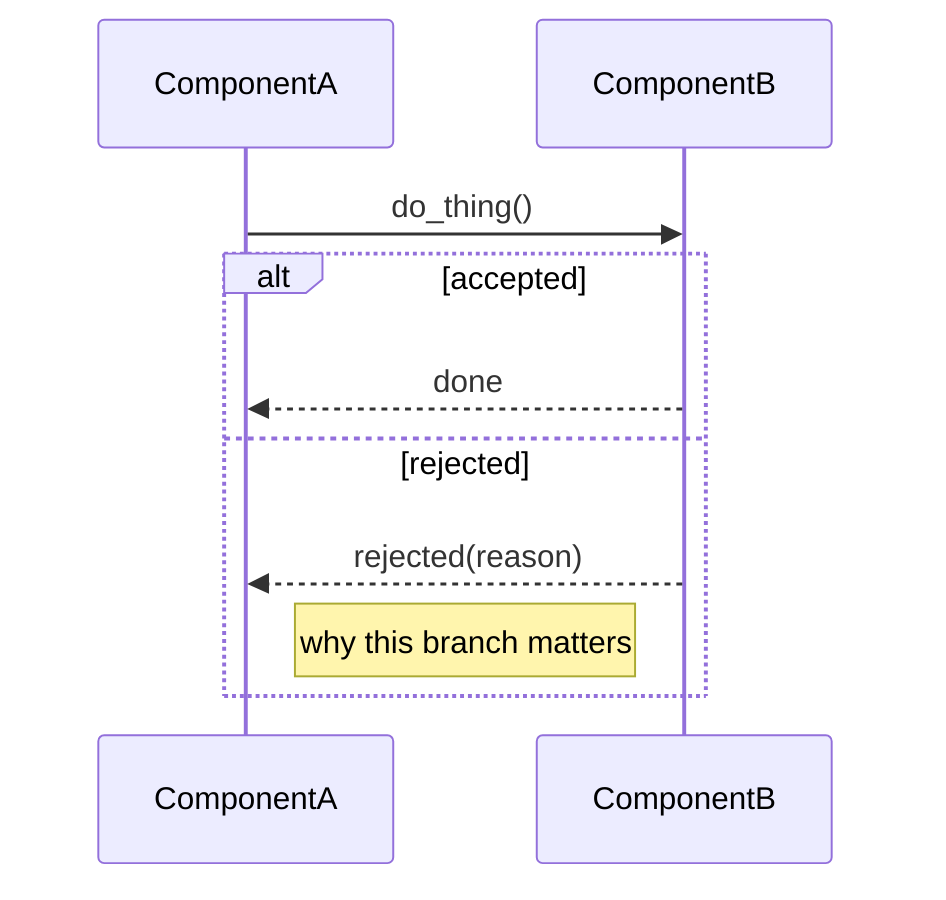

# <Feature Name> (#issue)

<!-- Copy to docs/<feature-name>.md. One line on scope: what's in, what's explicitly NOT in (and which issue covers it). -->

## Pieces

<!-- What exists today that this touches, plus anything new. "Knows about" = its dependencies. -->

| Piece | Job | Knows about |
|-------|-----|-------------|
| | | |

<!-- One line on boundaries, e.g. "The modal never touches the network. The coordinator never touches UI." -->

## Flow

<!-- Sequence diagram: happy path + the branches that change behavior. See docs/mermaid-guide.md. -->
<!-- Max 6 participants. Solid arrow = call or RPC, dashed arrow = signal or return. Real method names. -->

## Decisions

<!-- Numbered. Bold title, then the call + why. Mark anything still up for debate as open. -->

1. **Decision title.** What we're doing, and why.

## Open questions

<!-- Checkboxes with a leaning. Confirm these with the user before implementing. -->

- [ ] Question? Leaning **answer**.
