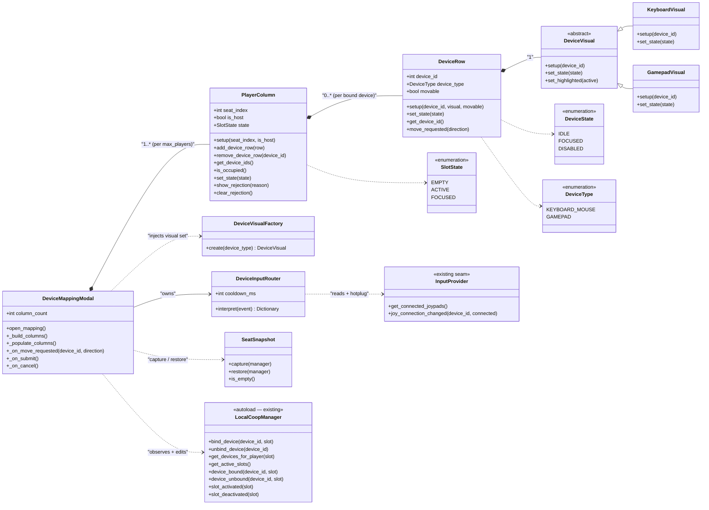

# Device Mapping Modal — Architecture & API Design

Status: design draft (nothing implemented). Replaces the monolith in
`scenes/ui/DeviceMappingModal.tscn` + `device_mapping_modal.gd`.

The goal is to split the modal into modular scenes (one per concern) so columns
and device rows can be instantiated to match `max_players`, and so each module
can grow independently (gamepad/keyboard art, animations, state toggling)
without touching its neighbors. SOLID, but pragmatic — no interfaces-for-the-sake-of-it.

---

## 1. Requirements (distilled)

- Column count is configurable (export default or per-open), never hardcoded.
- One column per **seat**; seat index == `local_player_id`. Seat 0 is the host.
- One row per **physical device**. A column holds 0..* devices (multi-pad per seat, D9).
- Render device-specific visuals: keyboard vs gamepad today, mouse/touch later.
- Toggle graphics/animations by **state** (active slot, focused, disconnected).
- Live-edit `LocalCoopManager`; on Submit emit `submitted`, on Cancel restore + emit `cancelled` (the caller decides how to commit).
- Handle hotplug (connect/disconnect mid-modal).
- MKB (`device_id == -1`) is a first-class row in column 0, pinned and non-movable.

---

## 2. SOLID — where each principle lands

| Principle | Where it lands | Why |
|-----------|----------------|-----|
| **S**RP | `DeviceMappingModal` = orchestration only. `PlayerColumn` = seat view. `DeviceRow` = device view. `DeviceVisual` = rendering. `DeviceInputRouter` = input→intent. `SeatSnapshot` = rollback. | The current modal does all six jobs in one 216-line script. Each new module changes for exactly one reason. |
| **O**CP | `DeviceVisual` hierarchy + `DeviceVisualFactory`. | Add a mouse/touch visual by subclassing `DeviceVisual` and adding a factory case. `DeviceRow`/`PlayerColumn` don't change. |
| **L**SP | `DeviceVisual` is an abstract base with a fixed contract (`setup`, `set_state`). | `DeviceRow` holds a `DeviceVisual` and doesn't care which subclass — keyboard and gamepad are drop-in interchangeable. |
| **I**SP | `DeviceRow` knows nothing about `LocalCoopManager` or networking — it's driven through a tiny `setup`/`set_state` API and one `move_requested` signal. `DeviceInputRouter` exposes only `interpret`. | No class is forced to depend on methods it doesn't use. |
| **D**IP | Modal depends on the `DeviceVisual` abstraction (not concrete visuals), on the `DeviceVisualFactory` seam, and on the autoloads' public signal surface — never on concrete row/visual nodes. | Swapping the visual set is injection, not editing. |

---

## 3. Class diagram



Notes on the arrows:

- **Composition** (`*--`): the modal owns its columns, columns own their rows, rows own their visual. Freeing the modal frees the tree.
- **Dependency** (`..>`): the modal *uses* but does not own the autoloads, factory, snapshot, and router. These are injected or looked up, not children.
- The modal never reaches into a `DeviceRow`'s internals. It talks to `PlayerColumn`, which talks to `DeviceRow`, which delegates drawing to `DeviceVisual`. Three levels, one responsibility per level.

---

## 4. Reactive data flow

The single most important architectural change: **`LocalCoopManager` is the only
source of truth.** The current modal keeps a parallel `_pads` dict and hand-
repaints rows — that's two sources of truth drifting apart. Instead, the modal
becomes a pure *projection* of `LocalCoopManager` state: it subscribes to the
autoload's signals and re-parents rows in response. No `_pads`, no manual
re-render.

```mermaid
sequenceDiagram
    actor U as User / Dev
    participant M as DeviceMappingModal
    participant R as DeviceInputRouter
    participant LCM as LocalCoopManager
    participant PC as PlayerColumn

    U->>M: open_mapping()
    M->>LCM: get_devices_for_player(seat) for 0..column_count-1
    M->>M: snapshot.capture(LCM)
    M->>M: _build_columns(column_count)
    loop each bound device (incl. MKB)
        M->>PC: setup(seat, is_host) + add_device_row(row)
    end

    Note over U,R: gamepad 3 presses dpad-right
    R->>M: interpret(event) => {device:3, direction:+1}
    M->>LCM: bind_device(3, seat+1)
    LCM-->>M: device_bound(3, new_seat)
    M->>PC: move row into new column
    LCM-->>M: slot_activated(new_seat)
    M->>PC: set_state(ACTIVE)

    U->>M: Submit
    Note over M: emits `submitted`; a caller (lobby) commits.<br/>The modal knows nothing about the network.

    U->>M: Cancel
    M->>M: snapshot.restore(LCM)
    LCM-->>M: device_bound(...) for each reverted device
```

The loop is closed: any mutation (user move, hotplug, cancel)
goes through `LocalCoopManager`, which emits a signal, which the modal turns
into a UI change. The UI never mutates itself directly.

---

## 5. Public API (the contract)

### DeviceMappingModal (composition root)

```
open_mapping(player_count = -1)             # build columns, snapshot, subscribe, popup
column_count : int                          # @export default; override per open
_on_move_requested(device_id, direction)    # single entry point for all move intents
signal submitted                            # user confirmed (bindings live in LCM)
signal cancelled                            # user cancelled (bindings restored)
```

Subscribes to: `LocalCoopManager.device_bound / device_unbound / slot_activated /
slot_deactivated`, `InputProvider.joy_connection_changed`. Does **not** know
about the network — a caller connects `submitted` to commit.

### PlayerColumn (seat view)

```
setup(seat_index: int, is_host: bool)
add_device_row(row: DeviceRow) / remove_device_row(device_id: int)
get_device_ids() -> Array[int]
is_occupied() -> bool                       # has >= 1 device (drives Submit)
set_state(state: SlotState)                 # EMPTY | ACTIVE | FOCUSED → toggles visuals
show_rejection(reason) / clear_rejection()
```

### DeviceRow (device view)

```
setup(device_id: int, visual: DeviceVisual, movable: bool)
set_state(state: DeviceState)               # IDLE | FOCUSED | DISABLED
get_device_id() -> int
signal move_requested(direction: int)       # own affordances (click/buttons) only
```

The row does **not** read the global joypad — that's the router's job. Its own
`move_requested` signal exists so future per-row UI (click "◀"/"▶" buttons) can
feed the same `_on_move_requested` path.

### DeviceVisual (abstract)

```
setup(device_id: int)                       # build the graphic
set_state(state: DeviceState)               # drive animations / tint / overlay
set_highlighted(active: bool)               # optional focus pulse
```

This is the seam where "gamepad art, keyboard art, background images,
animations" all live. Add a visual = subclass + one factory line.

### DeviceVisualFactory

```
create(device_type: DeviceType) -> DeviceVisual
```

Injected into the modal. Swap the whole visual theme (or add a new device type)
without editing the modal, column, or row.

### DeviceInputRouter

```
interpret(event: InputEvent) -> { device_id: int, direction: int } | null
cooldown_ms : int                            # 200ms axis-spam guard (moved here)
```

Pure logic extracted from the modal's current `_unhandled_input`: filters
joypad events, applies cooldown, maps dpad-left/right + left-stick-x to ±1.
Unit-testable headlessly with no UI.

### SeatSnapshot

```
capture(manager)   # store device→slot map at open
restore(manager)   # re-bind every device to its captured slot
is_empty() -> bool
```

### Enums

```
SlotState   : EMPTY | ACTIVE | FOCUSED      # column-level
DeviceState : IDLE | FOCUSED | DISABLED     # row/visual-level
DeviceType  : KEYBOARD_MOUSE | GAMEPAD      # future: MOUSE, TOUCH
```

---

## 6. Invariants & pitfalls (read before implementing)

- **MKB is pinned to seat 0, non-movable.** `DeviceRow.movable == false` for
  `device_id == -1`. The router never emits a move intent for `-1`; the modal
  ignores one if it does.
- **Sparse → contiguous.** `LocalCoopManager` allows `[0, 3, 7]`, but the modal
  presents contiguous columns `0..column_count-1`. Clamp any seat to that range
  on both populate and move (the old `clampi` guard survives, relocated).
- **Seat == `local_player_id`.** No translation layer (D2). Column `i` is seat
  `i` is `local_player_id i`.
- **Multi-device per seat.** `is_occupied()` is true per **column** (>= 1 device),
  so a future commit step creates one player per occupied column, never per row (D9).
- **Cancel restores = re-entrancy.** `snapshot.restore()` re-binds devices,
  which re-fires `device_bound`. Disconnect the modal's subscriptions *before*
  restoring, then hide — otherwise the closing modal re-parents rows pointlessly.
- **Partial success is valid.** Seat 1 accepted + seat 2 rejected must not roll
  back seat 1 (D6). Rejection reverts only the rejected column.
- **MKB is now rendered.** Unlike today (gamepads only), `get_devices_for_player(0)`
  returns `[-1, ...gamepads]`, so the keyboard row appears in column 0 for free
  via the reactive populate — no special-case enumeration needed.
- **Commit is a caller concern.** The modal emits `submitted` and stops there.
  D1 (host self-add via `LobbyManager`) is a caller-side problem, out of scope
  for this modal.

---

## 7. Where future functionality lands

| Feature | Goes here | Doesn't touch |
|---------|-----------|---------------|
| Gamepad/keyboard art, animations | `GamepadVisual` / `KeyboardVisual` | row, column, modal |
| New device type (mouse, touch) | new `DeviceVisual` subclass + `DeviceVisualFactory` case | row, column, modal |
| Background/overlay per seat state | `PlayerColumn.set_state` | modal |
| Device name + id label | `DeviceRow` | visual, column |
| Per-row click/button movement | `DeviceRow` (`move_requested` signal) | router, modal |
| 8-player scale | `open_mapping(8)` (or the `column_count` export) | nothing |
| Mouse-driven column switching | `DeviceInputRouter.interpret` | modal, columns |

---

## 8. File layout

```
scenes/ui/device_mapping/
    DeviceMappingModal.tscn      # shell: column container + button row
    device_mapping_modal.gd      # orchestrator (slimmed)
    PlayerColumn.tscn            # seat column (header + rows + rejection label)
    player_column.gd
    DeviceRow.tscn               # one device (visual + label)
    device_row.gd
    device_visual.gd             # abstract base (no scene)
    keyboard_visual.gd           # placeholder art (swap for a scene later)
    gamepad_visual.gd
    device_visual_factory.gd
    device_input_router.gd
    seat_snapshot.gd
```

Cross-refs: D1–D9 in `docs/issue-40-add-local-player.md` are the source decisions;
this doc makes them structural.
