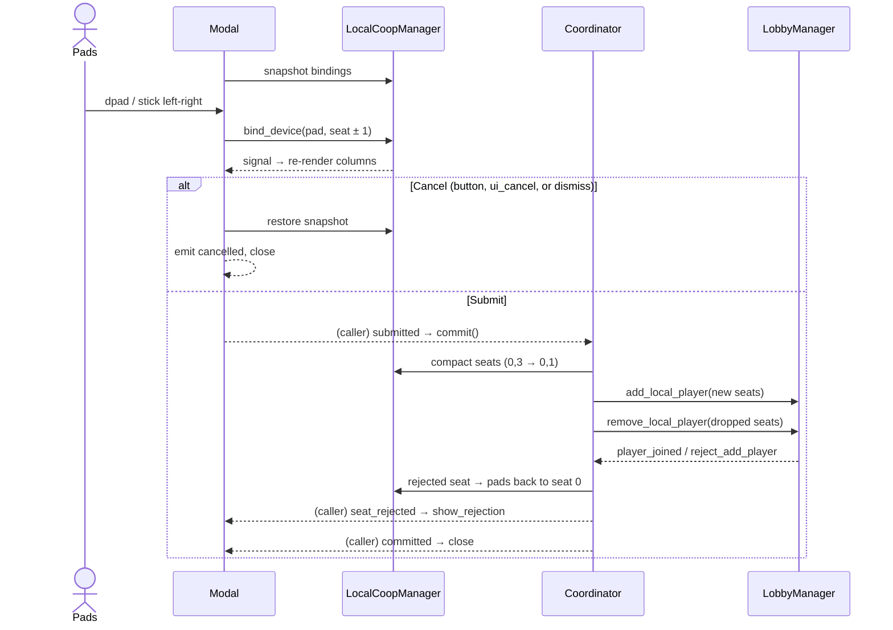

# Device Mapping (#40)

Bottom-up: build + test the components. **No existing scene or lobby flow changes** — wiring into the lobby/pause menus is #51.

## Pieces

| Piece | Job | Knows about |
|---|---|---|
| `DeviceMappingModal` | Shows seats, lets pads move between them, Submit / Cancel | `LocalCoopManager` only |
| `DeviceInputRouter` | Joypad event → "device N wants left/right" | Input actions |
| `SeatSnapshot` | Remembers bindings at open, restores on Cancel | `LocalCoopManager` |
| `LocalSeatCoordinator` | Submit → compact seats → ask the lobby for add/remove → report rejections | `LocalCoopManager` + `LobbyManager` |
| `LobbyManager.add/remove_local_player` | Public wrappers over the existing RPCs | network |

The modal never touches the network. The coordinator never touches UI. The caller (#51) glues them.

## Flow

## Decisions

1. **Re-render, don't diff.** Any `LocalCoopManager` signal → rebuild columns from state. ≤8 seats, it's free, and it kills the re-parent / `call_deferred` sync bugs.
2. **Art via exported `PackedScene`s, not a factory.** `gamepad_row_scene` / `keyboard_row_scene` on the modal. Drops `DeviceVisual`, `KeyboardVisual`, `GamepadVisual`, `DeviceVisualFactory`.
3. **Compact on submit** (lives in the coordinator). Occupied seats get renumbered contiguous, order kept. The modal allows gaps while editing.
4. **Diff against the lobby, not the snapshot.** Desired = occupied seats after compaction. Existing = `LobbyManager.get_local_players()`. Add the missing ones, remove the extras. The server is the truth.
5. **Rejection = that seat only.** Its pads go back to seat 0; accepted seats stay. No re-compaction after a reject (it's rare — "lobby full" rejects the tail anyway).
6. **Modal stays open on Submit** until the caller calls `close()`, so rejections can show. Submit disables input while pending.
7. **Every close path resolves.** Cancel button, `ui_cancel`, click-outside / dismiss → all go through cancel. No silent close.
8. **`Control` overlay instead of `PopupPanel`.** Easier to theme, no embedded-window focus weirdness. Full-rect blocker eats mouse clicks behind it.
9. **Input via actions, edge-triggered.** Exported action names (default `ui_left` / `ui_right` / `ui_accept` / `ui_cancel`), read per joypad event. The stick has to return to center before it moves again. Handled in `_input` so the GUI focus system can't eat it.
10. **Cancel restore = "every currently bound pad → its snapshot seat, unknown → seat 0".** Handles hotplug and unplug mid-modal, no ghost re-binds.
11. **Out-of-range seats grow the columns** (`max(column_count, highest seat + 1)`). Nothing goes invisible.
12. **Seat 0 is "P1", not "Host".** Labels go through `tr()`; colors come from the theme, not code.
13. **Host self-add.** `add_local_player` sends `_request_add_player.rpc_id(1, ...)` so `get_remote_sender_id()` resolves on the host too. Verify with a network test.

## Open questions

- [ ] Who can Submit with `ui_accept`? Any pad (simple), or only seat 0 devices (stops a guest mashing A)? Leaning **seat 0 only**.
- [ ] Coordinator timeout if the server never answers? Leaning **no timeout in v1** — reliable RPC, and the caller can still Cancel.
- [ ] Removing a seat that's already in the lobby: just fire `remove_local_player` and trust `player_left`? Leaning **yes**.
