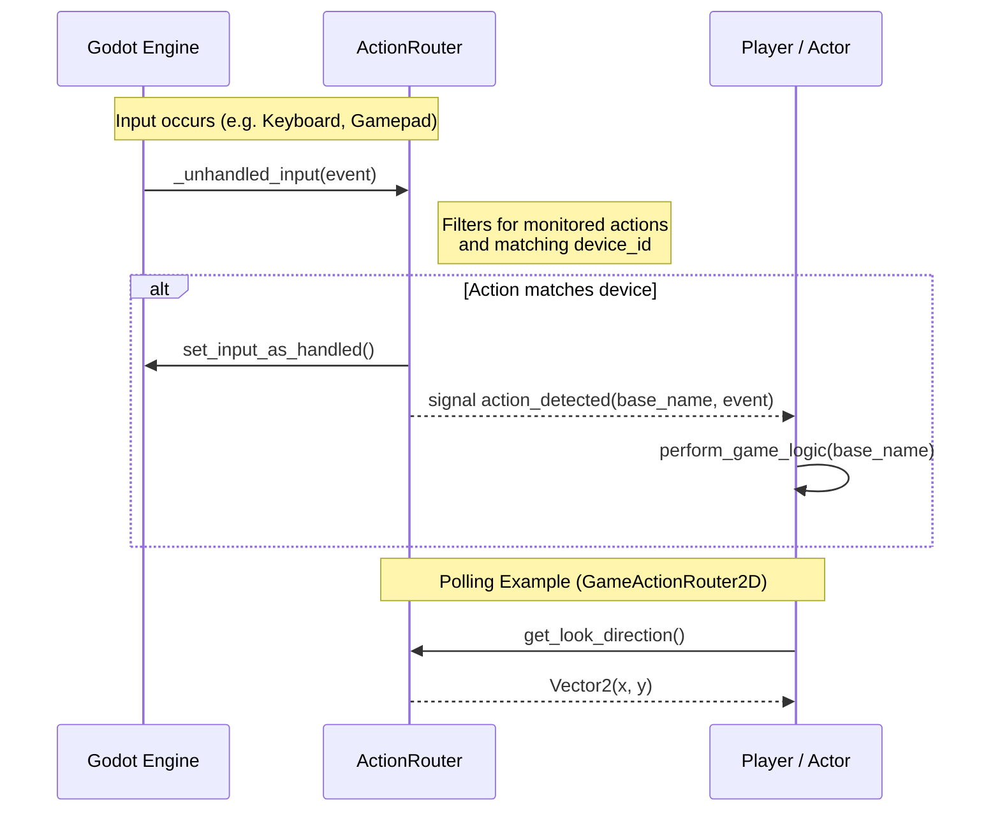
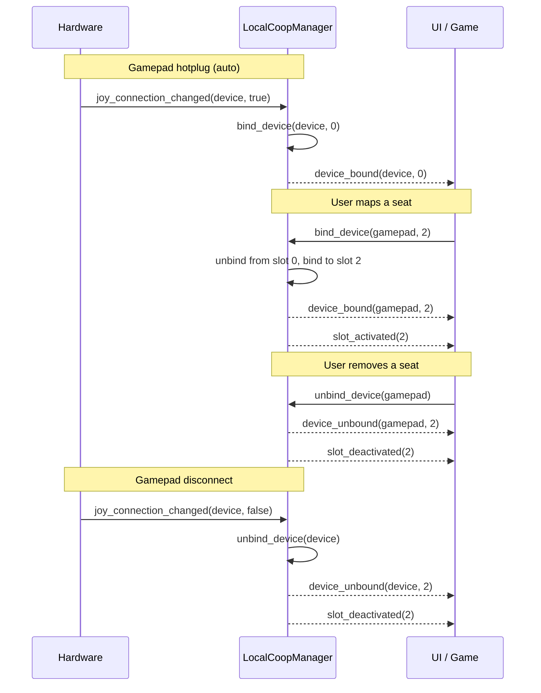

# Input System 🎮

Handling input directly inside your Player script often leads to spaghetti code. This template uses an **Action Router** pattern to keep things clean and multiplayer-ready.

## The Concept

Instead of checking `Input.is_action_pressed("jump")` inside your Player implementation, we separate the "Input" from the "Action".

- **The Router (`ActionRouter`)**: Detects raw inputs (Keyboard, Gamepad, etc.) and maps them to device-agnostic actions.
- **Device Isolation**: The router can automatically clone and prefix actions (e.g., `move_left_device_0`) to allow multiple controllers to work without conflict.
- **The Actor**: Your Player script queries the Router or connects to its signals to react to gameplay intents.

### Signal Flow

## Why do this?

- **Multiplayer Ready**: Easily assign `device_id` to different players. The template handles the `InputMap` cloning for you.
- **Input Neutrality**: Swap between Human, AI, or any other inputs by swapping the `ActionRouter` node.
- **Testing**: Mock inputs easily by calling `action_detected.emit()` from your test scripts.
- **Hybrid Look Logic**: `GameActionRouter2D` automatically switches between Mouse and Gamepad look logic depending on the last used device.

## Files

- `action_router.gd`: The base class. Handles the heavy lifting of `InputMap` cloning and device filtering.
- `game_action_router_2d.gd`: Adds high-level features like normalized look-direction sensing (Mouse absolute vs. Stick relative).
- `local_coop_manager.gd`: Autoload that owns the device→seat mapping. Emits signals for UI binding. No network effects.
- `input_provider.gd`: Thin wrapper around `Input.get_connected_joypads()` — enables DI mocking in tests via GUT `double()`.

## Local Co-op Device Mapping (`LocalCoopManager`)

`LocalCoopManager` owns the real-time mapping from physical input devices to local player slots (seats). It tracks which gamepad belongs to which seat and emits signals so the UI can react. It does NOT trigger network effects — the lobby handshake for spawning or removing `LobbyPlayer` nodes is consumed via these signals in a separate layer.

### API

**Mapping**

- `bind_device(device_id, slot)` — Assign a gamepad to a slot. Auto-unbinds from any previous slot. No-op for MKB.
- `unbind_device(device_id)` — Release a gamepad. No-op for MKB or unknown devices.

**Queries**

- `get_player_for_device(device_id) → int` — Which slot this device maps to (0 if unbound).
- `get_devices_for_player(slot) → Array[int]` — All device IDs bound to this slot.
- `get_active_players() → int` — Count of distinct slots that have ≥1 device.
- `get_is_coop() → bool` — True when more than one slot is active.
- `get_active_slots() → Array[int]` — List of active slot indices (sparse — e.g. [0, 3]).
- `has_available_gamepad() → bool` — True when slot 0 has MKB + ≥1 gamepad.

**Signals**

- `device_bound(device_id, slot)` — A device was bound to a slot.
- `device_unbound(device_id, slot)` — A device was unbound (explicit call or disconnect).
- `slot_activated(slot)` — A slot went from empty to having ≥1 device.
- `slot_deactivated(slot)` — A slot went empty. Never fires for slot 0.

### Constraints & Invariants

- **MKB is permanently slot 0.** `bind_device(MKB, ...)` and `unbind_device(MKB)` are no-ops. Slot 0 is always active — it never emits `slot_deactivated`.
- **Auto-unbind on rebind.** If gamepad 0 is on slot 2 and you `bind_device(0, 3)`, it unbinds from slot 2 first. A single device can never appear in two slots.
- **Gamepad detection.** Gamepads already connected at startup are enumerated in `_ready()` and auto-bound to slot 0. Subsequent hotplugs are handled via `Input.joy_connection_changed` (connect → bind to slot 0, disconnect → unbind). Both paths emit `device_bound` / `device_unbound`.
- **Sparse slots are valid.** Active slots can be [0, 3] — no requirement for consecutive numbering.
- **Unbound devices default to slot 0.** `get_player_for_device(unknown)` returns 0, so single-player code works without explicit binding.

### Flow

